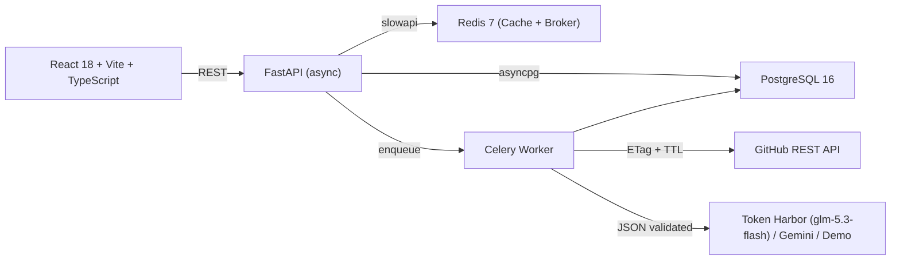

# RepoPulse

> **Open-source repository intelligence: turn any public GitHub repo into clear engineering signals, Health Score, and verifiable AI insights.**

[](https://fastapi.tiangolo.com/)
[](https://react.dev/)
[](https://www.typescriptlang.org/)
[](https://docs.celeryq.dev/)
[](https://www.docker.com/)
[](LICENSE)

RepoPulse analyzes public GitHub repositories via read-only REST APIs, computes transparent engineering metrics and a versioned **Health Score (v1.1)** in background Celery workers, caches responses in Redis with volatility-based TTLs and `ETag` conditional requests, persists results in PostgreSQL, and presents reports in a responsive React + TypeScript UI.

> **Live Demo:** *[URL(https://repo.b3mug1.dev/) (see [docs/OPERATIONS.md](docs/OPERATIONS.md)).*  
> **Case Study & Engineering Trade-offs:** [docs/CASE_STUDY.md](docs/CASE_STUDY.md)

## Features

| Area | Capabilities |
|---|---|
| **Engineering Metrics** | Sampled commits (up to 100 / 5 pages), commit velocity (`commits/day`, `commits/30d` in UTC), code churn, avg commit size, bus factor (by GitHub login -> email -> name), language distribution |
| **Health Score (v1.1)** | Weighted 5-factor score (`activity`, `collaboration`, `documentation`, `testing`, `automation`), normalized over measured signals (`unknown` ≠ `0`), coverage %, confidence (`high`/`medium`/`low`), and actionable findings |
| **Ecosystem & Delivery** | Pull requests (open ratio, close time), Issues (open age, resolve time), Releases (tag & cadence), CI/Actions runs, License, Branch Protection, `CODEOWNERS`, and 7d/30d/90d activity windows |
| **Verifiable AI & Demo Mode** | Token Harbor (`glm-5.3-flash`) or Gemini with Pydantic JSON validation, file/signal `evidence_refs`, role-based summaries (`Developer` / `Manager` / `Recruiter`), data-sent disclosure, and deterministic **Demo Mode** without an API key |
| **Product Workflows** | Filterable/sortable History, side-by-side Comparison (same repo over time or two repos), Re-analyze / Retry / Cancel, Saved Repos, time-limited revocable Share Links, UTF-8 CSV export (with formula escaping), and Print/PDF report |
| **Accessibility & i18n** | `EN / RU` switcher, `prefers-reduced-motion`, keyboard `:focus-visible`, skip-to-content link, ARIA chart regions |

## Architecture



### Clean Architecture Layers

| Layer | Directory | Responsibility |
|---|---|---|
| **Domain** | `backend/app/domain/` | Entities, repository ports, pure metric & Health Score logic |
| **Use Cases** | `backend/app/usecases/` | Application orchestration (`AnalyzeRepositoryUseCase`, `GetAnalysisUseCase`) |
| **Infrastructure** | `backend/app/infrastructure/` | PostgreSQL (SQLAlchemy + Alembic), Redis (`CachedGitHubClient`), GitHub/AI clients, Celery tasks |
| **API** | `backend/app/api/` | FastAPI routes, Pydantic schemas, DI, proxy-safe rate limiting |

## Quick Start

### Prerequisites

- [Docker](https://docs.docker.com/get-docker/) & [Docker Compose](https://docs.docker.com/compose/)
- *(Optional)* `GITHUB_TOKEN` — increases GitHub API rate limit from 60 to 5,000 req/hr
- *(Optional)* `TOKENHARBOR_API_KEY` (or `GEMINI_API_KEY`) — without a key, RepoPulse runs in deterministic **Demo Mode**

### Run Locally (Development)

```bash
cp backend/.env.example backend/.env
docker compose up --build
```

| Service | URL |
|---|---|
| Frontend | http://localhost:4200 |
| API | http://localhost:8000 |
| Swagger UI (dev only) | http://localhost:8000/docs |
| Health & Metrics | http://localhost:8000/api/v1/health and `/api/v1/health/metrics` |

For production deployment, backups, and migrations, see [docs/OPERATIONS.md](docs/OPERATIONS.md) and [docs/SECURITY_AND_PRIVACY.md](docs/SECURITY_AND_PRIVACY.md).

## API Endpoints

| Method | Path | Description |
|---|---|---|
| `POST` | `/api/v1/analyses/analyze` | Queue repository analysis (`202 Accepted`) |
| `GET` | `/api/v1/analyses/{id}` | Get analysis report, Health Score, sample scope, and extended signals |
| `GET` | `/api/v1/analyses/history` | Paginated history with `status`, `search`, and sorting |
| `GET` | `/api/v1/analyses/compare` | Compare two analyses (`left_id`, `right_id`) with deltas |
| `POST` | `/api/v1/analyses/{id}/retry` | Retry a failed or cancelled analysis |
| `DELETE` | `/api/v1/analyses/{id}` | Cancel an in-progress analysis |
| `POST` | `/api/v1/analyses/{id}/share` | Create time-limited share link with visibility flags |
| `GET` | `/api/v1/analyses/shared/{token}` | Fetch publicly shared report |
| `GET` | `/api/v1/analyses/{id}/export.csv` | Download UTF-8 BOM CSV with source URL & formula escaping |
| `GET` | `/api/v1/health` | Real PostgreSQL, Redis, and Celery worker health check |
| `GET` | `/api/v1/health/metrics` | Operational metrics (duration, GitHub errors, cache hit rate, queue depth) |

## Environment Variables

| Variable | Description | Default |
|---|---|---|
| `APP_ENV` | `development` \| `staging` \| `production` | `development` |
| `APP_SECRET_KEY` | Required in production (`>= 32` chars) | *(empty)* |
| `POSTGRES_*` | PostgreSQL connection (`POSTGRES_PASSWORD` required in prod) | `localhost:5432` |
| `REDIS_URL` | Redis cache URL | `redis://localhost:6379/0` |
| `GITHUB_TOKEN` | GitHub PAT for higher rate limits | *(empty)* |
| `TOKENHARBOR_API_KEY` | Token Harbor API key (`glm-5.3-flash`) | *(empty — Demo Mode)* |
| `GEMINI_API_KEY` | Optional Google Gemini fallback key | *(empty)* |
| `TRUSTED_PROXIES` | Comma-separated proxy IPs allowed to set `X-Forwarded-For` | *(empty)* |
| `CORS_ORIGINS` | Allowed frontend origins | `http://localhost:4200,http://localhost:5173` |

## Limitations & Methodology

- **Sampled commit window:** Analyses inspect up to the **100 most recent commits** (5 GitHub API pages) rather than cloning full git history. Every report explicitly displays `sample_scope` and truncation status.
- **Heuristic Health Score:** Missing signals (e.g., unavailable tree or unconfigured AI) are marked `unknown` and excluded from normalization rather than scored as `0`. File-path heuristics do not prove test coverage or passing CI.
- **No individual developer evaluation:** Contributor counts and Bus Factor measure repository continuity risk on sampled commits, never individual developer productivity or candidate quality.
- **AI transparency:** Model outputs (`ai_summary`, `role_summaries`) are labeled as model interpretations, validated via Pydantic, and paired with `evidence_refs` and a `data_sent_disclosure`.

## Running Tests & Quality Checks

```bash
# Backend unit, API, migration, security, and ops tests
cd backend
pytest tests/unit -v
ruff check .

# Frontend typecheck, lint, unit tests, and production build
cd frontend
npm run typecheck && npm run lint && npm test && npm run build
```

## Screenshots & Demo

> Add screenshots of the landing page, report dashboard, and a short walkthrough GIF here after deploying your demo environment.

## License

MIT — see [LICENSE](LICENSE).
